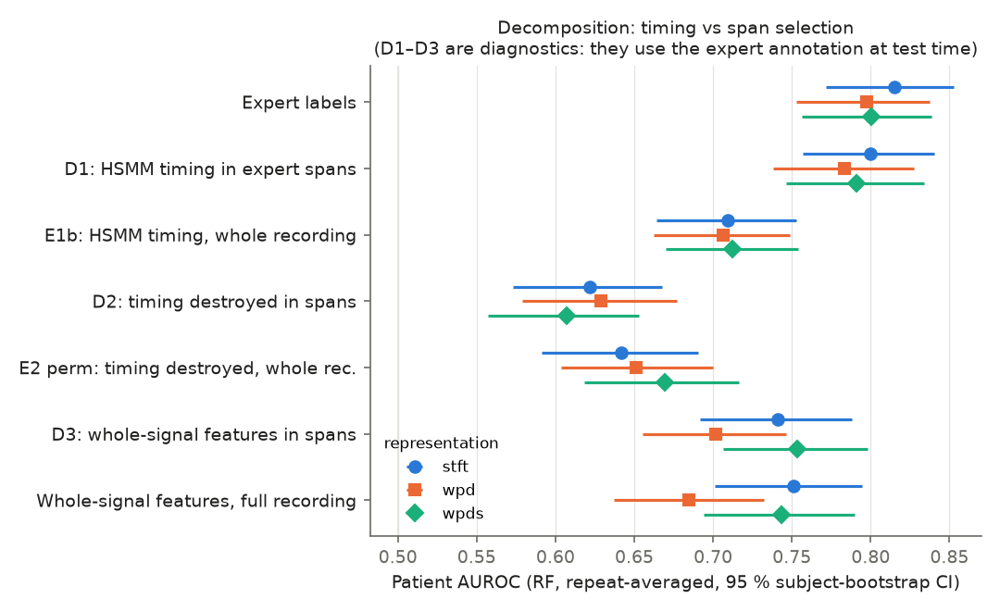
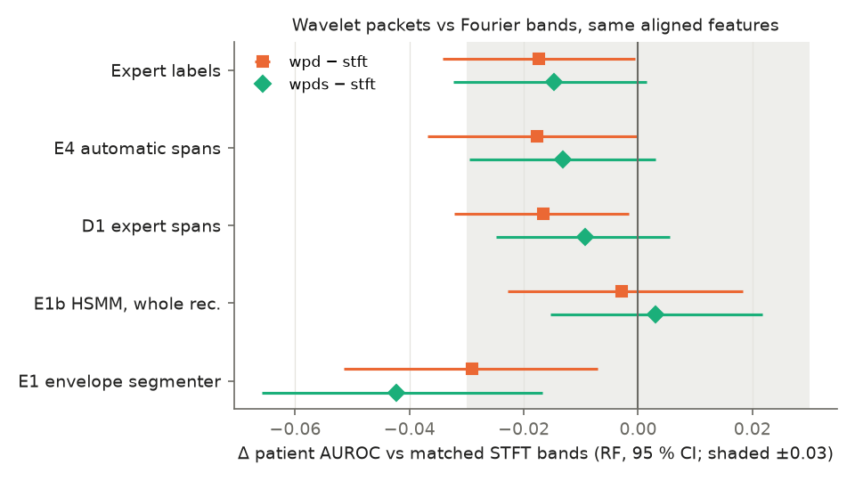

# Physiology-Aligned Multiresolution Analysis for Patient-Independent Heart-Murmur Detection: A Comparative Study of Wavelet and Fourier Features

**EC418 — Biomedical Instrumentation and Signal Processing**, National Institute of Technology Warangal.
Mini Research Project (Assignment 2): Medical Signal Analysis and Disease Diagnosis. Author: Parth Mishra.

A pre-registered, patient-independent study of heart-murmur detection from phonocardiograms (PCG) on the public
PhysioNet CirCor DigiScope dataset, comparing wavelet-packet, Fourier (STFT) and wavelet-scattering features under
cardiac-cycle-aligned and whole-signal designs, with WEKA classifiers, shortcut-learning controls and an external test.

> **Start here:** [`docs/INDEX.md`](docs/INDEX.md) (all documents, in order) · [`docs/RESULTS_SUMMARY.md`](docs/RESULTS_SUMMARY.md)
> (final Phase 1–2 results) · [`docs/P3_RESULTS.md`](docs/P3_RESULTS.md) (Phase 3) ·
> [`docs/INTERPRETATION_GUIDE.md`](docs/INTERPRETATION_GUIDE.md) (what the results do and do not support) ·
> [`docs/REPRODUCIBILITY.md`](docs/REPRODUCIBILITY.md) · [`submission/`](submission/) (report and slides).

## 1. Research overview
A **heart murmur** is an extra sound produced by turbulent blood flow, heard between the normal first (S1) and second (S2)
heart sounds. Murmurs can be innocent or a sign of structural heart disease (for example a septal defect or a valve
lesion), and in low-resource settings auscultation is often the only available screening tool. Detecting that a murmur
is **present** is a screening question; it is **not** a diagnosis of the underlying disease, which needs
echocardiography. This project addresses murmur detection only.

* **Why patient-independent evaluation:** CirCor has several recordings per child and some children were recorded at
  more than one visit. If recordings of the same child appear in both training and test data, a model can recognise the
  child rather than the murmur. All results here are evaluated per patient on folds that keep every child (and every
  linked visit) on one side.
* **Why wavelets:** murmurs are short, non-stationary events, and the wavelet packet transform gives a multiresolution
  time–frequency view that is widely used in the PCG literature, including the 2025 *Scientific Reports* baseline
  re-implemented here.
* **Why Fourier features as well:** to know whether wavelets help, they must be compared with an equally strong,
  carefully matched Fourier representation (STFT bands with the same edges, time grid and dimension).
* **Research question:** does a physiology-aligned (cardiac-cycle-aware) representation improve patient-level murmur
  detection, and is any gain due to the wavelet transform itself or to the alignment with the cardiac cycle?

## 2. Key research findings
<!-- BEGIN:results -->
**Table 1 — CirCor, patient level, 874 patients, 5 repeats × 5 subject-grouped folds.**

| Model (WEKA RandomForest) | Segmentation used at test time | Mean of repeat AUROCs ± SD | AUROC of repeat-averaged scores [95 % CI] | Source |
|---|---|---|---|---|
| Expert-aligned STFT bands (E2 `true`) | expert annotation (oracle) | 0.811 ± 0.007 | 0.815 [0.772, 0.853] | Phase 2 |
| Expert-aligned WPD db4 (E2 `true`) | expert annotation (oracle) | 0.793 ± 0.008 | 0.798 [0.753, 0.838] | Phase 2 |
| Automatic spans, STFT (E4) | LR-HSMM + learned span detector | 0.803 ± 0.009 | 0.809 [0.766, 0.849] | Phase 2 |
| Automatic spans, WPD db4 (E4) | LR-HSMM + learned span detector | 0.784 ± 0.009 | 0.791 [0.746, 0.831] | Phase 2 |
| Automatic spans, shortcut-free, STFT (E4q) | same fraction of windows per recording | 0.793 ± 0.008 | 0.799 [0.756, 0.842] | Phase 3 |
| Whole-signal STFT bands (W_stft) | none | 0.744 ± 0.010 | 0.751 [0.701, 0.794] | Phase 2 (Mac) |
| Whole-signal WPD db4 (W_wpd_db4) | none | 0.678 ± 0.014 | 0.685 [0.637, 0.732] | Phase 2 (Mac) |
| Reproduced 2025 wavelet baseline (B1, Vimalajeewa et al.) | none | 0.721 ± 0.008 | 0.726 [0.677, 0.773] | Phase 1 (frozen, Linux) |

**Table 2 — Pre-registered contrasts (RF).**

| Contrast (RF, Δ AUROC of repeat-averaged scores) | Hypothesis | Δ [95 % CI] | Folds Δ > 0 | Recorded verdict | Type |
|---|---|---|---|---|---|
| Timing destroyed (expert labels permuted), STFT | H5b | +0.174 [+0.115, +0.229] | 25/25 | SUPPORTED | confirmatory |
| Wavelet packets vs matched STFT bands, aligned | H2a | −0.017 [−0.034, 0.000] | 3/25 | NOT SUPPORTED | confirmatory |
| Aligned vs whole-signal WPD | H3 | +0.113 [+0.065, +0.165] | 25/25 | SUPPORTED | confirmatory |
| Automatic (E4) vs expert labels, WPD (primary) | H9a | −0.007 [−0.044, +0.031] | 10/25 | SUPPORTED | confirmatory; rule = point estimate ≥ −0.03 (see note) |
| Automatic (E4) vs whole-signal STFT, WPD (primary) | H9c | +0.040 [−0.003, +0.089] | 21/25 | NOT SUPPORTED | confirmatory |
| E4 vs whole-signal STFT + span/missingness shortcut, STFT | S1(a) | +0.043 [−0.005, +0.096] | 21/25 | possibly shortcut-driven | diagnostic (pre-registered after E4) |
| Shortcut-free E4q vs whole-signal STFT + shortcut, STFT (primary) | H12a | +0.046 [−0.001, +0.093] | 23/25 | possibly shortcut-driven | confirmatory (Phase 3) |

*Note on H9a.* The pre-registered rule was a point-estimate criterion (Δ ≥ −0.03), and it is met (Δ = −0.007), so the recorded verdict stays SUPPORTED. Formal statistical non-inferiority within −0.03 is **not** established, because the 95 % CI lower bound (−0.044) lies below −0.03; clinical equivalence is not demonstrated.

External test (Phase 3, H10a, pre-registered): W_stft RF trained once on all 874 CirCor patients, applied unchanged to the ZCHSound clean set (941 children, 408 with congenital heart disease): AUROC 0.709 [0.675, 0.741] for any CHD (a diagnosis label, not a murmur label); noisy neonatal set (318): 0.535 [0.471, 0.597], i.e. chance.

*Generated by `scripts/p5_readme_tables.py` from `results/tables/` — do not edit by hand.*
<!-- END:results -->

**What these results support** (details and caveats: [`docs/INTERPRETATION_GUIDE.md`](docs/INTERPRETATION_GUIDE.md)):
1. **Cardiac-cycle timing carries the murmur information.** With the same features, destroying the alignment to the
   expert S1/systole/S2/diastole labels lowers AUROC in all 25 folds (H5a–d). The diagnostics attribute this to timing
   within the annotated spans, not to the expert's choice of spans.
2. **The transform does not matter.** Wavelet packets were never better than matched STFT bands (H2a/H2b not
   supported), equivalence within ±0.03 was not shown either, and wavelet scattering did not beat STFT bands (H11a/b).
   STFT is the stronger or equal comparator throughout; no wavelet superiority is claimed.
3. **Automatic segmentation needs span selection.** Envelope peaks (E1) and an LR-HSMM on the whole recording (E1b) did
   not reach the pre-registered targets. With a learned span detector (E4) the point estimate is within the
   pre-registered −0.03 of expert labels (H9a rule met), **but statistical non-inferiority within −0.03 is not
   established**: the CI lower bound is about −0.044.
4. **Part of the automatic gain may be a shortcut.** E4's span fraction and missingness alone predict the class. Once a
   whole-signal STFT model receives the same information, E4's margin has a CI that includes zero (S1), and the
   shortcut-free variant E4q likewise does not establish a gain (H12a lower bound −0.001).
5. **External test (Phase 3).** A whole-signal STFT model trained on CirCor transfers to an independent paediatric
   cohort (ZCHSound) with the physiological subtype order (H10a/b supported). ZCHSound is labelled with **congenital
   heart disease diagnoses, not murmurs**, so this is not an external murmur validation; on the noisy neonatal subset
   every model is at chance. There is no external clinical validation and no CirCor hidden-test evaluation.

## 3. Main contributions (no new algorithm is claimed)
* **A. Baseline reproduction and evaluation audit** — the 2025 wavelet baseline re-implemented and re-evaluated with
  subject-grouped instead of random recording-level splits (H1; [`docs/BASELINE_AUDIT.md`](docs/BASELINE_AUDIT.md)).
* **B. Patient-independent comparison of signal representations** — WPD (four mother wavelets), STFT and scattering under
  identical features, folds and classifiers.
* **C. Controlled physiology-aligned vs whole-signal comparison** — a 2 × 2 {transform} × {aligned, whole} design.
* **D. Automatic segmentation evaluation** — envelope peaks, LR-HSMM and a learned span detector against expert labels.
* **E. Timing and shortcut-learning analysis** — label-permutation and shift nulls, diagnostics D1–D3, the shortcut
  controls S1 and E4q.
* **F. Transparent reporting** — every hypothesis pre-registered with a decision rule; failed hypotheses, errata and
  post-hoc analyses are reported as such.

## 4. Methodology
```
PCG recording (4 kHz) → resample 2 kHz, band-pass 25–900 Hz, z-score
  → cardiac-cycle segmentation: expert .tsv labels (oracle)  |  envelope peaks (E1)  |  LR-HSMM (E1b)
                                |  LR-HSMM + learned span detector (E4, E4q)
  → band features per cycle phase: WPD db4 depth 4 (16 × 62.5 Hz bands) | matched STFT bands | wavelet scattering
  → patient vector: median and maximum over the patient's recordings
  → WEKA 3.9.7 (RandomForest primary; SMO secondary; MLP, Logistic in Phase 1)
  → held-out patients: 5 repeats × 5 subject-grouped outer folds, inner-fold thresholds, subject bootstrap CIs
```
Expert annotations are used at test time only in the experiments labelled "expert" or "oracle" (E2 `true`, D1–D3);
E1, E1b, E4 and E4q segment test recordings automatically, with all models trained on the training folds only. Full
methods: [`submission/`](submission/) report, [`docs/PROTOCOL_LOCKED.md`](docs/PROTOCOL_LOCKED.md) (Phase 1),
[`docs/PROTOCOL_V2_LOCKED.md`](docs/PROTOCOL_V2_LOCKED.md) (Phase 2), [`docs/PROTOCOL_V3_PREREG.md`](docs/PROTOCOL_V3_PREREG.md)
(Phase 3), [`docs/WEKA_SETUP.md`](docs/WEKA_SETUP.md).

## 5. Dataset
* **CirCor DigiScope Phonocardiogram Dataset v1.0.3** — <https://physionet.org/content/circor-heart-sound/1.0.3/>
  (Oliveira et al., IEEE JBHI 2022; open access, ODC-By 1.0). Training set: 942 patients, 3,163 recordings from up to four
  auscultation sites, murmur labels Present / Absent / Unknown, expert S1/systole/S2/diastole segmentation.
* **Task:** Present vs Absent; Unknown excluded → 874 patients (179 Present, 695 Absent).
* **Patient identity:** linked visits share an `Additional ID`; grouping patients by it gives 816 subjects, and folds
  never split a subject ([`docs/DATASET_AUDIT.md`](docs/DATASET_AUDIT.md), `configs/folds_patient_level.csv`, sha256 in
  `configs/folds_patient_level.sha256`).
* **Provenance:** Phase 1 used a byte-identical redistribution of the training set; Phase 2 verified the official
  PhysioNet v1.0.3 download (all 10,434 files match PhysioNet's `SHA256SUMS.txt`) and uses it exactly as downloaded
  ([`docs/PROVENANCE_PHYSIONET.md`](docs/PROVENANCE_PHYSIONET.md); decision: amendments D1/D2 in
  [`docs/PROTOCOL_V2_LOCKED.md`](docs/PROTOCOL_V2_LOCKED.md)).
* **External cohort (Phase 3):** ZCHSound (Jia et al., IEEE TBME 2024; CC BY 4.0), 1,259 children, echocardiography-based
  CHD labels; used for testing only.
* **No raw recordings are stored in this repository**; `data/raw/` and `data/interim/` are git-ignored. Derived features
  (`data/processed/`) and per-patient predictions (`results/predictions/`) are included.

## 6. Repository structure
```
README.md · CITATION.cff · THIRD_PARTY_NOTICES.md · pyproject.toml
configs/      locked protocols (JSON) and lock hashes, frozen folds + sha256, environment records, frozen requirements
docs/         INDEX, protocols (v1, v2, v3), results per experiment, errata, provenance, interpretation, reproducibility
src/ec418/    data loading/subject linkage · preprocessing · wavelets (WPD, STFT bands, baseline DWT port)
              segmentation (envelope peaks, LR-HSMM port, spans) · features · evaluation (folds, metrics) · weka (ARFF, Java runner)
scripts/      01–10  Phase 1: audit, features, baseline, folds, leakage test, WEKA runs, analysis, figures, post-hoc smoothing
              12–32  Phase 2: provenance (12), Mac reproduction (13, 14, 17), E2 (15, 16, 23), E1 (18–20), E1b (21, 22),
                     diagnostics (24, 25), E4 (26–28), S1 (29, 30), final figures and summary (31, 32)
              p3_*   Phase 3: scattering (G4), ZCHSound (G1a), shortcut-free E4q (G2), conditioning gaps (G3a), checks
              p4_*   write-up: numbers registry, figures, tables, slides, number check, literature-search records
              p5_*   README tables
tests/        pytest suite (81 tests)
results/      tables/ predictions/ figures/ figures_final/ logs/; v1_freeze/ and final_freeze/ checksum manifests
references/   baseline repository snapshot (MIT), official Challenge scoring code (BSD-2-Clause), dataset checksums,
              literature-search records (g3b/)
report/       short IEEE-format paper draft, numbers registry (numbers.json / numbers.tex), figures, slides
submission/   EC418 deliverables: research report (PDF + LaTeX source), presentation (PPTX), checklist
weka_demo/    one fold reproduced with the WEKA command line, and steps for the WEKA Explorer GUI
tools/        WEKA 3.9.7 jars (GPL-3.0) and the compiled batch runner
experiments/  ARFF files of the WEKA runs (large ones git-ignored)
```

## 7. Installation (macOS Apple Silicon or Linux)
Tested on macOS 26.6 (Apple M5 Pro) with Python 3.12.14 and OpenJDK 21.0.13; Phase 1 ran on Ubuntu with Python 3.13 and
OpenJDK 21.0.12 (`configs/environment_mac.txt`, `configs/environment.txt`).
```bash
# Python 3.12 + uv; Java 17 or later (macOS: brew install openjdk@21, then export PATH="/opt/homebrew/opt/openjdk@21/bin:$PATH")
uv venv -p 3.12 .venv && uv pip install -p .venv -e .
# exact versions used: configs/requirements_frozen.txt (drop its "-e file:///..." line, which is the original machine's path)
grep -v '^-e ' configs/requirements_frozen.txt > /tmp/ec418_req.txt && uv pip install -p .venv -r /tmp/ec418_req.txt
# WEKA 3.9.7 jars are committed in tools/ — nothing to download. Phase 3 scattering needs a second env (.venv-scat with
# kymatio 0.3.0; see scripts/p3_01_scattering_features.py). Report/slides: tectonic, python-pptx (uv pip install -e ".[writeup]").
```
**Data placement:** download CirCor v1.0.3 from PhysioNet (`wget -r -N -c -np https://physionet.org/files/circor-heart-sound/1.0.3/`)
and link its `training_data/` to `data/raw/circor_training_data` (`ln -s <download>/training_data data/raw/circor_training_data`).
ZCHSound (Phase 3 only) is passed to `scripts/p3_02_external_zch.py` as a path argument. No environment variables are
required; the literature-search scripts take an optional contact e-mail from `EC418_CONTACT_EMAIL`.

## 8. Reproducing the results
See [`docs/REPRODUCIBILITY.md`](docs/REPRODUCIBILITY.md) for the full, three-level guide. In short:
* **A. Verify the stored results (minutes, no data needed):**
  `shasum -a 256 -c results/v1_freeze/MANIFEST_v1.sha256` and `shasum -a 256 -c results/final_freeze/MANIFEST_final.sha256`
  (Linux: `sha256sum -c`), plus the protocol and fold hashes in `configs/`.
* **B. Reproduce Phase 1:** scripts `01`–`07` (feature extraction, folds, WEKA, analysis) on the raw data.
* **C. Reproduce Phase 2 and 3:** the command tables at the top of each results document (`docs/E2_RESULTS.md`,
  `E1_RESULTS.md`, `E1b_RESULTS.md`, `D_DIAGNOSTICS.md`, `E4_RESULTS.md`, `S1_SHORTCUT.md`, `P3_RESULTS.md`).
* **D. Regenerate tables and figures from saved predictions:** `scripts/07_analyze.py`, `31_final_figures.py`,
  `32_results_summary.py` — these write into frozen paths, so run them in a disposable `git worktree` and compare hashes.
* **E. Tests:** `.venv/bin/python -m pytest -q` (81 tests).

## 9. Results and figures


*Patient AUROC (RF, repeat-averaged, 95 % CI) by labelling and representation. Rows D1–D3 use the expert annotation at
test time and are diagnostics. Destroying timing (D2, E2 perm) removes most of the gain; whole-signal features are lower.*



*WPD and smoothed WPD minus matched STFT bands under each labelling (shaded: ±0.03). No labelling shows a wavelet advantage.*

## 10. Limitations
* Cross-validation on one public cohort; no CirCor hidden test set and no prospective or clinical evaluation.
* No intrinsic wavelet superiority was demonstrated; STFT bands were at least as good.
* Aligned results depend on segmentation and span selection; the expert-label results are oracle-conditioned.
* Only 179 Present patients; CIs are wide (typically ±0.04 AUROC).
* Part of the automatic-pipeline signal may be a span/missingness shortcut (S1, H12a not established).
* The Unknown class is excluded, so the task is easier than the three-class Challenge task.
* The external cohort tests CHD diagnosis, not murmur detection, and fails on noisy neonatal recordings.
* Murmur detection is not a clinical outcome diagnosis; nothing here supports deployment.
* E1b, E4, S1 and Phase 3 were designed after earlier results on the same folds (sequential design).

## 11. Reproducibility and research integrity
* **Frozen before results:** the v1 protocol and patient folds (commit "Lock protocol and folds before modelling"), the
  Phase-2 protocol (tag `protocol-v2-lock`) and each later experiment (tags `e1b-prereg`, `diag-prereg`, `e4-prereg`,
  `s1-prereg`); Phase 3 was pre-registered in a separate workspace (`protocol-v3-prereg`, see `results/logs/p3_mac_provenance.txt`).
* **Subject-grouped folds** in Python; WEKA's row-wise cross-validation is never used; identifiers are never features.
* **Saved predictions** for every run; every reported number comes from a script and a saved table
  (`report/numbers.json`, checked by `scripts/p4_check_numbers.py`).
* **Hypothesis tests** with pre-registered rules; subject-bootstrap CIs (2000 resamples); thresholds from inner folds.
* **Checksums:** `results/v1_freeze/MANIFEST_v1.sha256`, `results/final_freeze/MANIFEST_final.sha256`, protocol and fold hashes.
* **Negative results, errata and amendments** are kept: [`docs/ERRATA_v1.md`](docs/ERRATA_v1.md),
  [`docs/ERRATA_PHASE2.md`](docs/ERRATA_PHASE2.md), the "Amendments" sections of the protocols.
* **History:** commit metadata was normalised to the sole author on 2026-10-29 without changing any file
  ([`docs/HISTORY_REWRITE.md`](docs/HISTORY_REWRITE.md); old hashes resolve via `results/history_hash_map.csv`).
* **AI assistance disclosure:** this project was carried out with substantial assistance from an AI coding assistant
  (Anthropic's Claude, used through Claude Code). It wrote most of the code, ran the analyses, drafted the documentation,
  report and slides, and performed the literature screening and the transcription of the Google Scholar export. The
  author defined the study, made the decisions recorded in the protocols and amendments, and is responsible for the
  content. Commit metadata names the author only; this statement is the disclosure.

## 12. References
1. J. Oliveira et al., "The CirCor DigiScope dataset: from murmur detection to murmur classification," *IEEE JBHI*, 26(6),
   2022. Dataset: <https://physionet.org/content/circor-heart-sound/1.0.3/>.
2. M. A. Reyna et al., "Heart murmur detection from phonocardiogram recordings: The George B. Moody PhysioNet Challenge 2022,"
   *PLOS Digital Health*, 2(9), e0000324, 2023 (official scoring code in `references/official_eval/`).
3. D. Vimalajeewa, C. Lee, B. Vidaković, "Multiscale analysis of heart sound signals in the wavelet domain for heart murmur
   detection," *Scientific Reports*, 2025, doi:10.1038/s41598-025-93989-0 (code: github.com/chihoon1/Murmur).
4. D. B. Springer, L. Tarassenko, G. D. Clifford, "Logistic regression-HSMM-based heart sound segmentation," *IEEE TBME*, 63(4), 2016.
5. Jia et al., "ZCHSound: open-source ZJU paediatric heart sound database with congenital heart disease," *IEEE TBME*, 71(8), 2024.
6. Further 2024–2026 work compared in the report: [`docs/P4_CASE_STUDY.md`](docs/P4_CASE_STUDY.md),
   [`docs/P4_RELATED_WORK_CHECK.md`](docs/P4_RELATED_WORK_CHECK.md).

How to cite this repository: [`CITATION.cff`](CITATION.cff).

## 13. Licensing
No licence has been chosen yet for the project's own code, so by default all rights are reserved by the author; see
[`docs/LICENSING_DECISION_REQUIRED.md`](docs/LICENSING_DECISION_REQUIRED.md). Third-party components keep their own
licences ([`THIRD_PARTY_NOTICES.md`](THIRD_PARTY_NOTICES.md)): WEKA 3.9.7 jars (GPL-3.0), the LR-HSMM port in
`src/ec418/segmentation/lr_hsmm.py` (derived from GPL-3.0 code, distributed under GPL-3.0), the baseline repository
snapshot (MIT), the PhysioNet Challenge scoring code (BSD-2-Clause), CirCor-derived data (ODC-By 1.0) and
ZCHSound-derived scores (CC BY 4.0).
